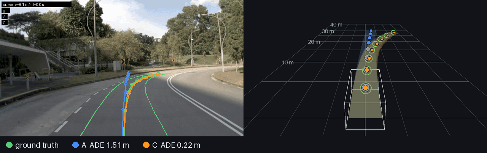
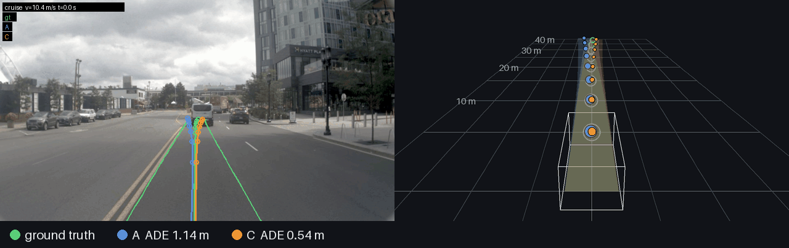
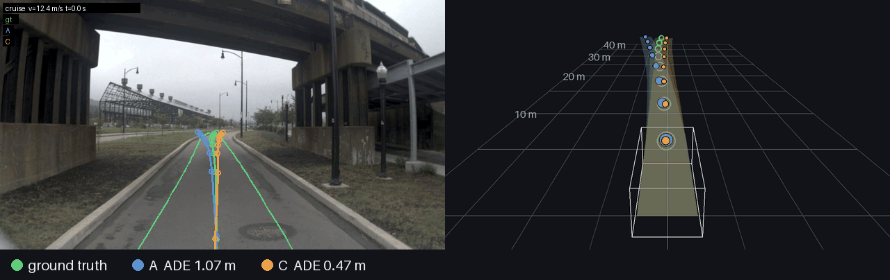
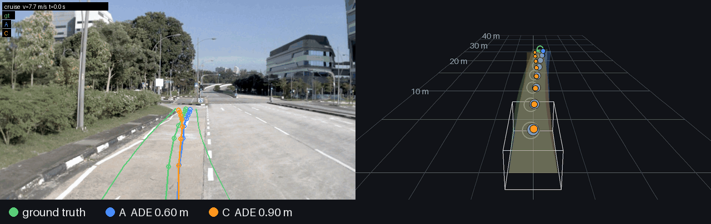

# Predicting the ego trajectory from a front camera

This project predicts where a car will drive over the next 4 seconds. It uses the last 2 seconds
of front-camera video, the car's own recent motion and the navigation command (left / straight /
right). The question behind it is how much the camera actually adds on top of the car's
kinematics, and in which situations.

- **Data:** [NAVSIM](https://github.com/autonomousvision/navsim) (`navtrain` for training, `navtest` for evaluation), built on [OpenScene](https://github.com/OpenDriveLab/OpenScene) / [nuPlan](https://www.nuscenes.org/nuplan).
- **Input:**
  - front-camera frames at t0 − 1.5, −1.0, −0.5 and 0 s;
  - ego poses over the same 2 s, plus current velocity, acceleration and yaw rate;
  - the driving command.
- **Output:** 8 waypoints (x, y, yaw) at 0.5 s steps in the ego frame.
- **Metrics:** ADE / FDE of the most likely trajectory, miss rate (FDE > 2 m), and lateral / longitudinal error. These are open-loop metrics, broken down by scenario.

<p align="center"></p>
<p align="center"></p>
<p align="center"></p>
<p align="center"></p>

<sub>navtest, consecutive samples at 2 Hz from a single drive.
<b>Green</b>: ground truth. <b>Blue</b>: model A (kinematics only). <b>Orange</b>: model C (camera + kinematics).
Left: camera frame with the trajectories projected through the real calibration. Right: the same trajectories in a 3D view.
The first three clips are where C beats A by the most: a right turn (mean ADE 1.47 → 0.42 m), braking behind a bus (1.30 → 0.44 m) and a curvy stretch (1.23 → 0.64 m).
The last clip is a random pick (0.87 → 0.52 m). Random clips are not always this favourable: in 4 out of 6, A has the lower mean ADE, because on regular driving kinematics are enough.</sub>

## Results

navtest: 12,146 samples from drives never seen in training. Errors are in metres over 4 s.

| model | inputs | ADE | FDE | miss rate | lateral | longitudinal |
|---|---|---|---|---|---|---|
| B0 | constant speed and yaw rate | 2.41 | 5.97 | — | — | — |
| A | kinematics | 0.783 | 2.04 | 39.5 % | 0.31 | 0.62 |
| B | camera + current speed | 1.194 | 2.61 | 50.9 % | 0.34 | 1.05 |
| C | camera + kinematics | 0.719 | 1.68 | 30.0 % | 0.23 | 0.62 |
| C, final | + input augmentation, auxiliary loss | **0.693** | **1.66** | **29.8 %** | **0.23** | **0.59** |

All learned models also receive the driving command.

- **The camera helps.** C improves on A by 11 % in ADE, 19 % in FDE and 25 % in miss rate, with the same ranking on the validation split.
- **The gain is mostly lateral, i.e. road geometry.** The lateral error drops by 26 % and FDE improves by 25–29 % on curves and turns. The longitudinal error (when to brake or accelerate) barely moves.
- **The gain grows with the horizon.** At 1 s C is slightly worse than A (0.17 vs 0.14 m); at 4 s it is clearly better (1.66 vs 2.04 m).
- **The camera anticipates braking, but does not help once braking has started.** C cuts the FDE by 37 % at the onset of strong braking, and is 3 % worse during braking already under way.

## How it works

**Data.**
- The source archives are far larger than the local disk, so everything is processed shard by shard, tracked in a SQLite manifest so runs can resume.
- The camera archives are streamed and only the front-camera frames that NAVSIM samples use are kept, re-encoded at 960×540 (~14 GB).
- Each sample stores its ego-frame history and future, the kinematic inputs, QC flags and a scenario tag.
- Splits are by drive: 91k train / 11k val from `navtrain`, plus the official `navtest`.

**Features.**
- Frozen DINOv2 ViT-B/14 with registers, run once offline, so training never touches images.
- Per frame: the CLS token, plus the patch grid pooled to 6×10 cells and reduced to 256-d with PCA.
- ~5 GB for 170k frames, which fits in GPU memory: a 30-epoch run takes about 10 minutes on an RTX 3090.

**Model.** One transformer for all variants. They differ only in the input tokens:

```
kinematics + command  ──► MLP ──────────────────────────► 1 token    ┐
CLS × 4 frames        ──► linear + time embedding ──────► 4 tokens   ├─► encoder (4 layers, d=256) ──► decoder with K queries ──► K trajectories + scores
6×10 grid × 4 frames  ──► linear + time/cell embedding ─► 240 tokens ┘
```

- **A:** kinematics token only. **B:** vision tokens + current speed. **C:** all tokens.
- **Anchors:** each query predicts an offset from a k-means anchor trajectory, and the query whose anchor is nearest the ground truth gets the loss. This keeps mode assignment stable; plain winner-takes-all did not train.
- **Final model:** K=1, plus two training-only additions: feature noise and token dropout on the visual inputs, and an auxiliary head predicting the features 1–2 s ahead.

## Usage

```bash
make image && make test                       # Docker dev image (CPU) and test suite
make ingest                                   # front-camera frames (CPU, streaming)
make run ARGS="samples --split test --name navtest --filter navtest"

python -m egopred features --device cuda      # GPU from here on
for v in A C; do python -m egopred train --name $v --variant $v --anchors --lr 1e-4 --k 1 --device cuda; done
python -m egopred compare A C --split test
```

Code: `egopred/` (pipeline, features, model, training, figures), `scripts/` (ingest and GPU-session helpers), `tests/`.

## Data licence

The camera frames in the GIFs come from [nuPlan](https://www.nuscenes.org/nuplan) (Motional) as distributed by [OpenScene](https://github.com/OpenDriveLab/OpenScene), under [CC BY-NC-SA 4.0](https://creativecommons.org/licenses/by-nc-sa/4.0/) and the nuPlan non-commercial licence. The GIFs in `assets/` are derived from them and released under CC BY-NC-SA 4.0.

## References

- Dauner et al., *NAVSIM: Data-Driven Non-Reactive Autonomous Vehicle Simulation and Benchmarking*, NeurIPS 2024. [arXiv:2406.15349](https://arxiv.org/abs/2406.15349)
- OpenScene Contributors, *OpenScene: The Largest Up-to-Date 3D Occupancy Prediction Benchmark in Autonomous Driving*, 2023. [github.com/OpenDriveLab/OpenScene](https://github.com/OpenDriveLab/OpenScene)
- Caesar et al., *nuPlan: A closed-loop ML-based planning benchmark for autonomous vehicles*, 2021. [arXiv:2106.11810](https://arxiv.org/abs/2106.11810)
- Oquab et al., *DINOv2: Learning Robust Visual Features without Supervision*, TMLR 2024. [arXiv:2304.07193](https://arxiv.org/abs/2304.07193)
- Darcet et al., *Vision Transformers Need Registers*, ICLR 2024. [arXiv:2309.16588](https://arxiv.org/abs/2309.16588)
